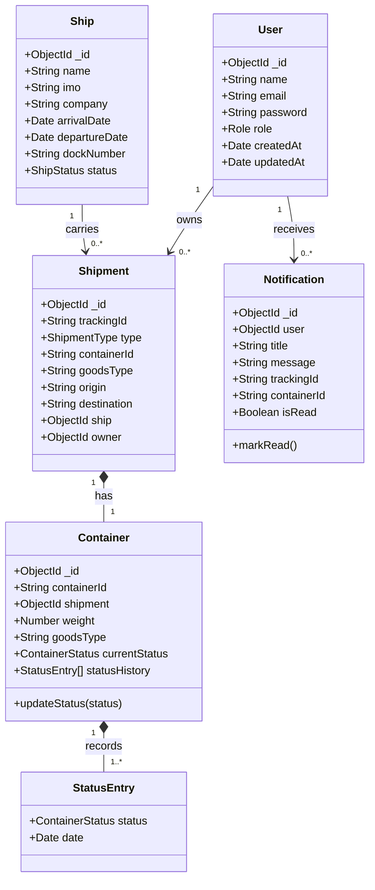
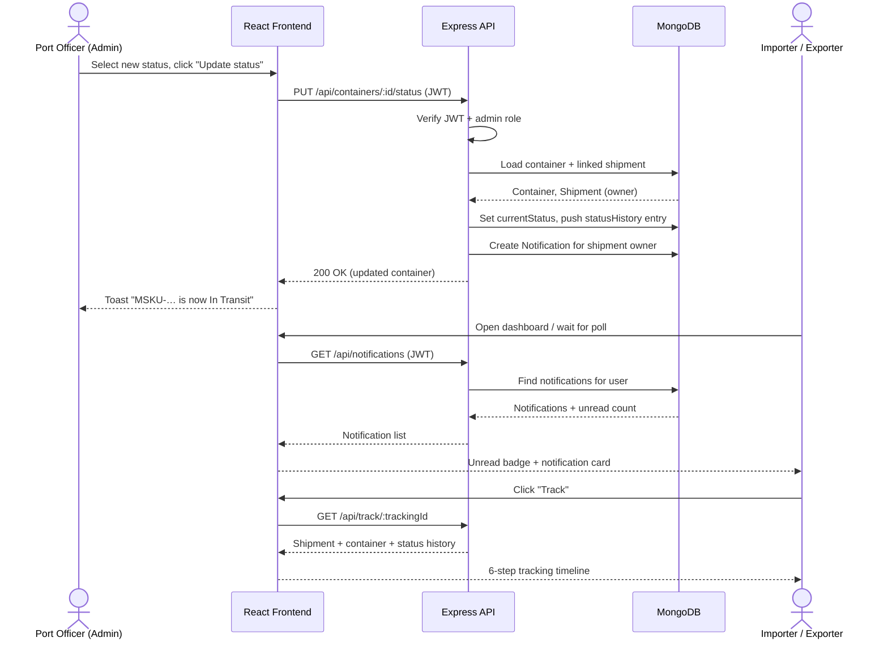
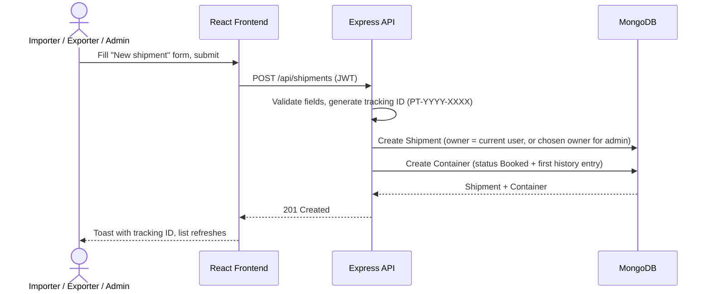
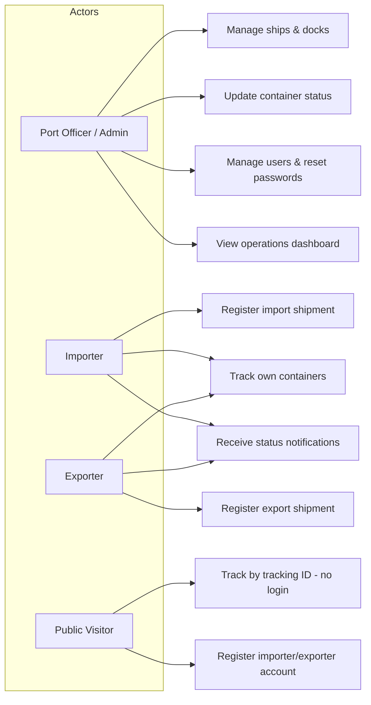

# PortTrack — UML Diagrams

Diagrams for **PortTrack: A Container Cargo Tracking System for Import & Export**.
Written in [Mermaid](https://mermaid.js.org/) syntax — GitHub renders them directly in this file.
The diagram sources are in [`docs/uml/`](uml/) (`.mmd` files) and can be exported to PNG/SVG
with any Mermaid renderer (e.g. mermaid.live) for use in reports and presentations.

---

## 1. Class Diagram

The five domain classes and their relationships, exactly as implemented in `models/`.

**Enumerations**

| Enum | Values |
|---|---|
| `User.role` | `admin` (Port Officer), `importer`, `exporter` |
| `Ship.status` | `Expected`, `Arrived`, `Departed` |
| `Shipment.type` | `import`, `export` |
| `Container.currentStatus` | `Booked`, `Loaded`, `In Transit`, `Arrived at Port`, `Customs Clearance`, `Delivered` |

---

## 2. Sequence Diagram — Container Status Update & Notification

What happens when a Port Officer (Admin) updates a container's status: the container's
history is appended, a notification is created for the shipment owner, and the owner
sees it on their next dashboard visit (the UI polls every 30 seconds).

---

## 3. Sequence Diagram — Shipment Registration

---

## 4. Use Case Overview

